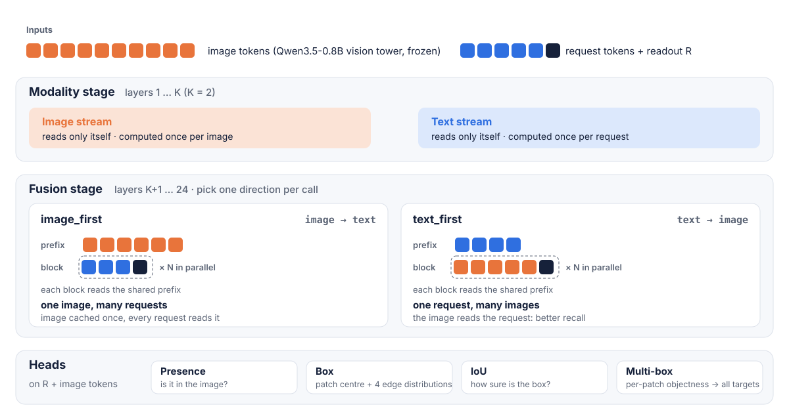

<p align="center">
  <picture>
    <source media="(prefers-color-scheme: dark)" srcset="assets/banner-dark.svg">
    
  </picture>
</p>

<p align="center"><b>English</b> · <a href="README.zh-CN.md">简体中文</a></p>

<p align="center">
  <a href="https://github.com/Vision-Decision/Glance-X/actions/workflows/ci.yml"></a>
  
  
  <a href="https://huggingface.co/Qwen/Qwen3.5-4B-Base"></a>
  <a href="https://huggingface.co/Vision-Decision/Glance-X-4B"></a>
  <a href="https://github.com/Vision-Decision/Glance-Data"></a>
  <a href="https://huggingface.co/datasets/Vision-Decision/Glance-Data"></a>
  
  <a href="LICENSE"></a>
</p>

<p align="center">
  <a href="#why-three-directions">Why</a> ·
  <a href="#how-it-works">How it works</a> ·
  <a href="#quick-start">Quick start</a> ·
  <a href="#results">Results</a> ·
  <a href="#train-your-own">Train</a> ·
  <a href="docs/ARCHITECTURE.md">Architecture</a> ·
  <a href="docs/RESULTS.md">Full results</a>
</p>

---

**Glance-X** finds objects in an image from a text request, such as *"the kid with glasses in the middle"* or
*"左边举起球拍的男孩"*. It answers with a **box** around every matching object, or says **the object is not in the
image**.

What makes it different is that **one set of weights runs in three directions**, and you pick the direction for each
call:

| Direction | Computed once and shared | Best for |
|---|---|---|
| `image_first` &nbsp;image → text | the image | one image, many requests, answered in parallel |
| `text_first` &nbsp;text → image | the request | one request over many images or video frames |
| `joint` &nbsp;image ⇄ text | nothing: image and request read each other | the most accurate answer for one pair |

<p align="center">
  
  <br>
  <sub>Real outputs of Glance-X-4B (K=8) on held-out images. <a href="assets/demo.mp4">MP4 version</a> ·
  made with <a href="demo/"><code>demo/</code></a> · images from MS COCO.</sub>
</p>

## Why three directions

Models that find objects from text usually fix the order in which they read their inputs, and that choice decides
which workloads are cheap:

- **Image first** (most vision-language models): the image is read once, and then any number of requests can be
  answered against it. Searching *many* images for *one* request is expensive, because the model reads each image
  without knowing what it is looking for.
- **Text first**: the request is read once, and every image is read already knowing what to look for. This suits
  search over a photo library or video frames, but asking many questions about one image repeats the image work.
- **Joint**: image and text attend to each other, as in Grounding DINO's fusion. This gives the best single answer,
  but nothing can be shared or cached.

Glance-X puts all three into **one model**. Caching and accuracy become a choice you make at inference time, not a
choice fixed when the model was trained.

## How it works

<p align="center">
  <picture>
    <source media="(prefers-color-scheme: dark)" srcset="assets/architecture-dark.svg">
    
  </picture>
</p>

Glance-X is built on **Qwen3.5-4B-Base**: 32 layers (24 Gated DeltaNet and 8 gated full-attention layers), with LoRA
r=64 on every language-model linear layer and a frozen vision tower.

1. **Modality stage** (layers 1…K, K=8 by default). The image tokens and the request tokens run as two separate
   streams. Neither can see the other, so each one can be computed once and cached. The request stream starts at a
   fixed position, so its cached features are the same whichever image it is later paired with.
2. **Fusion stage** (layers K+1…32). One stream becomes a shared *prefix* and the other becomes a *block* that reads
   it. Many blocks can share one prefix in a single forward pass:
   - `image_first`: prefix = image, block = [request, R]
   - `text_first`: prefix = request, block = [image, R]
   - `joint`: no prefix; block = [image, request, R], with attention running both ways inside the block
3. **Heads** read the readout token R and the image tokens:
   - **presence**: P(the request matches something in the image)
   - **box**: picks a patch centre, then predicts a 64-bin distribution for each of the four edges
   - **IoU**: P(the box overlaps the target with IoU ≥ 0.5)
   - **multi-box**: per-patch objectness, which yields one box for every target

The single-box recipe (presence gate, patch-centre softmax, edge distributions, IoU head) follows
[Glance](https://github.com/Vision-Decision/Glance). The three-direction backbone and the multi-box head are new in
Glance-X.

The prefix/block kernels are exact. With K=0 and a causal block mask, each direction equals a plain Hugging Face
forward of the equivalent single sequence ([image, request] or [request, image]).
[`scripts/test_equivalence.py`](scripts/test_equivalence.py) checks this, along with isolation between requests
that share a prefix. Details are in [docs/ARCHITECTURE.md](docs/ARCHITECTURE.md).

## Quick start

```bash
git clone https://github.com/Vision-Decision/Glance-X && cd Glance-X
pip install -e ".[fla]"        # drop [fla] on machines without a CUDA GPU
```

The weights are on Hugging Face: **[Vision-Decision/Glance-X-4B](https://huggingface.co/Vision-Decision/Glance-X-4B)**
(LoRA + heads, 547 MB; the 9 GB base model is downloaded on first use).

```python
from glancex import GlanceX

m = GlanceX.from_pretrained("Vision-Decision/Glance-X-4B")   # or your own exported folder / training .pt

# one image, many requests: the image is computed once
m.ask("tennis.jpg", ["the kid with glasses in the middle", "right racket", "左边举起球拍的男孩",
                     "boy on the left raising a blue racket", "a frisbee"])
# Result('the kid with glasses in the middle', present_prob=1.000, box=[249, 165, 381, 424], confidence=0.997, n_boxes=1)
# Result('right racket', present_prob=1.000, box=[528, 72, 632, 242], confidence=0.984, n_boxes=1)
# Result('左边举起球拍的男孩', present_prob=0.992, box=[65, 143, 253, 422], confidence=0.987, n_boxes=1)
# Result('boy on the left raising a blue racket', present_prob=0.040, box=[64, 120, 249, 422], confidence=0.038, n_boxes=0)
# Result('a frisbee', present_prob=0.000, box=[387, 93, 587, 330], confidence=0.000, n_boxes=0)

# one pair, most accurate; `boxes` holds every target
r = m.find("giraffes.jpg", "the three giraffes in the field", mode="joint")
r.boxes   # [[47, 62, 242, 316], [333, 69, 515, 312], [522, 101, 638, 314]]

# one request over many images: the request is computed once, results ranked by confidence
m.search("a giraffe eating from someone's hand", photos)[0]
# Result("a giraffe eating from someone's hand", present_prob=0.994, box=[307, 22, 585, 324], confidence=0.753, n_boxes=0)
```

These outputs are real (CUDA, bf16) and are the same predictions shown in the demo video.

| `Result` field | Meaning |
|---|---|
| `present_prob` | P(the request matches something in the image). Use it to reject requests. |
| `box` | the most likely target, `[x1, y1, x2, y2]` in pixels of the input image (filled in even when absent; gate on `present_prob`) |
| `iou_prob`, `confidence` | P(IoU ≥ 0.5) and `present_prob × iou_prob`, a single score to threshold or rank on |
| `boxes`, `box_scores` | every target found by the multi-box head, with its objectness score |
| `image_index` | which input image the result belongs to (for `search`) |

Each mode also accepts its aliases: `i2t` for `image_first`, `t2i` for `text_first`, and `bi` for `joint`.

## Results

All numbers are for **Glance-X-4B with K=8**, evaluated on the **full** test splits. Each direction is evaluated
separately with the same checkpoint. Results are reported in two groups.

### 1. Original benchmarks (human labels)

RefCOCO / RefCOCO+ / RefCOCOg, Acc@0.5 (%):

| Split | Glance-4B-preview<br><sub>(image-first only)</sub> | Glance-X<br>`image_first` | Glance-X<br>`text_first` | Glance-X<br>`joint` |
|---|:-:|:-:|:-:|:-:|
| RefCOCO val | **93.2** | 92.9 | 92.1 | 93.1 |
| RefCOCO testA | 94.5 | 94.8 | 93.9 | **94.9** |
| RefCOCO testB | **90.7** | 90.4 | 89.5 | 90.5 |
| RefCOCO+ val | **89.7** | 89.2 | 87.6 | 89.6 |
| RefCOCO+ testA | **93.3** | 93.0 | 91.6 | 93.1 |
| RefCOCO+ testB | 84.6 | 84.7 | 82.0 | **84.9** |
| RefCOCOg val | 90.0 | 90.0 | 89.3 | **90.3** |
| RefCOCOg test | 90.4 | **90.5** | 89.0 | **90.5** |
| **8-split mean** | 90.8 | 90.7 | 89.4 | **90.9** |

Glance-4B-preview numbers are from the [Glance README](https://github.com/Vision-Decision/Glance#benchmarks).

gRefCOCO (expressions with no target, one target, or several targets), %:

| Split | Metric | `image_first` | `text_first` | `joint` |
|---|---|:-:|:-:|:-:|
| val | AUROC of P(present) | 98.1 | 97.3 | **98.2** |
| val | no-target expressions rejected | **79.2** | 75.9 | 78.9 |
| val | multi-target: F1 of the box set | 77.3 | 78.1 | **82.7** |
| testA | multi-target: F1 of the box set | 72.7 | 73.4 | **78.3** |
| testB | multi-target: F1 of the box set | 63.8 | 66.5 | **72.2** |

The val split here is gRefCOCO val merged with RefCOCO val on the same images; this gRefCOCO release has no
single-target val expressions.

### 2. Glance-Data eval set (our own benchmark)

There are 23,586 requests on 300 held-out RefCOCO-val images, from
[Glance-Data](https://github.com/Vision-Decision/Glance-Data). The set covers short, long, casual and Chinese
requests, look-alike negatives, and multi-target requests. Selected kinds:

| Request kind | Metric | `image_first` | `text_first` | `joint` |
|---|---|:-:|:-:|:-:|
| short / medium / long | Acc@0.5 | 86.7 / 90.8 / 91.3 | 86.4 / 90.5 / 92.0 | **87.6 / 91.0 / 92.0** |
| category name only | Acc@0.5 | 85.0 | 86.5 | **86.7** |
| look-alike, wrong attribute | rejected | 94.9 | 93.8 | **95.0** |
| look-alike, wrong relation | rejected | 94.2 | 94.2 | **94.4** |
| group of targets | ≥1 target hit | 78.5 | 85.1 | **87.1** |
| every instance of a category | ≥1 target hit | 61.4 | 65.0 | **66.8** |
| all multi-target | F1 / exact count | 62.6 / 39.1 | 66.7 / 43.0 | **69.7 / 46.7** |
| English / Chinese | Acc@0.5 | 88.1 / 86.8 | 87.2 / 85.9 | 87.8 / 86.8 |

> [!IMPORTANT]
> The Glance-Data eval set has the same distribution as part of the training data, so these numbers measure how
> well the model learned the new request types. They are not a zero-shot benchmark. The labels are
> pipeline-generated, with about 90% precision on audit.

### What we learned

- **`joint` is the most accurate direction.** On the RefCOCO family it matches the single-direction Glance-4B-preview
  (90.9 vs 90.8 mean), and it is clearly better on multi-target requests (+5.4 F1 on gRefCOCO val over
  `image_first`).
- **`text_first` costs about 1.3 points** on RefCOCO compared with `image_first`, and it finds more of a group (+6.6
  points ≥1-hit on Glance-Data groups). Reading the image while already knowing the request helps with recall.
- **Rejection works in every direction.** AUROC of P(present) is ≥ 97.3 on gRefCOCO, and 94–100% of look-alike,
  count, position and near-category negatives are rejected.
- **There is still a gap.** An internal single-direction model, trained from the instruction-tuned Qwen3.5-4B on the
  original data only, scores 1.5–3.8 points higher on the RefCOCO family. We have not yet separated the possible
  causes: Base vs instruct start, the larger share of new data, and the K=8 split. See
  [docs/RESULTS.md](docs/RESULTS.md).

## Train your own

The whole run fits on **one GPU**: 6,100 steps (2 epochs) in about **3 hours on one H200**, with a 22 GB peak.

```bash
python scripts/prepare_refcoco.py --ann data/ann --out data/prep            # RefCOCO / + / g, gRefCOCO -> records
python scripts/merge_data.py --orig data/prep/train.jsonl \
    --aug data/glance-data/aug_train_all.jsonl --out data/train.jsonl       # + Glance-Data, one record per image
python -m glancex.train --cfg configs/glance-x-4b-k8.json                   # K=8 (default); configs/glance-x-4b-k0.json for K=0
```

| Setting | Value |
|---|---|
| data | 355k original requests (RefCOCO family + gRefCOCO negatives) + 1.83M Glance-Data requests; at least 1/3 of each image's sampled requests are original |
| direction per batch | `image_first` 50%, `text_first` 25%, `joint` 25% |
| requests per image | 24 (`image_first`), 3 pairs (`text_first`, `joint`) |
| optimisation | 8 images per step, AdamW, LR 2e-4 (LoRA) / 5e-4 (heads), cosine schedule, bf16 with fp32 LoRA |
| losses | presence BCE, patch-centre CE, Cramér + GIoU on edges, IoU-head BCE, focal objectness |

Evaluate one direction:

```bash
python -m glancex.evaluate --ckpt outputs/glance-x-4b-k8/ckpt_final.pt --mode joint \
    --sets refcoco_val,refcoco_testA,refcoco_testB,refcocog_val,grefcoco_val_merged \
    --glance_data data/glance-data/aug_val.jsonl --out results/k8_joint.json
```

See [docs/TRAINING.md](docs/TRAINING.md) for data layout, hardware notes and every config key.

## Repository layout

```
glancex/
  inference.py     GlanceX: from_pretrained / ask / find / search
  backbone.py      the three-direction Qwen3.5 backbone (modality stage + fusion stage)
  _layers.py       prefix/block kernels for Gated DeltaNet and attention layers
  heads.py         presence / box / IoU / multi-box heads and the loss
  data.py          records -> image streams and text streams
  train.py         training loop
  evaluate.py      per-direction evaluation, original benchmarks + Glance-Data
scripts/           data preparation, Hugging Face export, exactness test
demo/              predict.py + render.py: how the demo video was made
configs/           K=8, K=0 and a smoke-test config
tests/             CPU unit tests (run in CI)
```

## Limitations

- Natural images only. The model was trained on COCO-style photos, not on screenshots or documents.
- `text_first` and `joint` evaluate one (request, image) pair per block, so for many requests on one image,
  `image_first` is the efficient choice.
- Licenses differ by component. The code is Apache-2.0. The weights are CC BY-NC-SA 4.0 (non-commercial), because
  gRefCOCO and Glance-Data are for non-commercial research only.

## Citation

```bibtex
@software{glancex2026,
  title  = {Glance-X: one model, three ways to look},
  author = {Vision-Decision},
  year   = {2026},
  url    = {https://github.com/Vision-Decision/Glance-X}
}
```

## Acknowledgements

- [Qwen3.5](https://huggingface.co/Qwen/Qwen3.5-4B-Base): the base model.
- [Glance](https://github.com/Vision-Decision/Glance): the box recipe and training setup.
- Glance-Data ([GitHub](https://github.com/Vision-Decision/Glance-Data) ·
  [Hugging Face](https://huggingface.co/datasets/Vision-Decision/Glance-Data)): the new request types.
- [flash-linear-attention](https://github.com/fla-org/flash-linear-attention): Gated DeltaNet kernels.
- Datasets: RefCOCO / RefCOCO+ / RefCOCOg, gRefCOCO and MS COCO.
- Ideas: SAM 3 (presence token), Grounding DINO (bidirectional fusion), VLMo / BEiT-3 (mode-switchable backbones).
