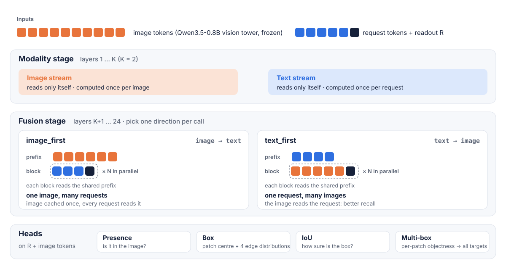

<p align="center">
  <picture>
    <source media="(prefers-color-scheme: dark)" srcset="assets/banner-dark.svg">
    
  </picture>
</p>

<p align="center"><a href="README.md">English</a> · <b>简体中文</b></p>

<p align="center">
  <a href="https://github.com/Vision-Decision/Glance-X/actions/workflows/ci.yml"></a>
  
  
  <a href="https://huggingface.co/Qwen/Qwen3.5-0.8B-Base"></a>
  <a href="https://huggingface.co/Vision-Decision/Glance-X-Lite"></a>
  <a href="https://github.com/Vision-Decision/Glanece-Training"></a>
  <a href="https://github.com/Vision-Decision/Glance-COCO"></a>
  <a href="https://huggingface.co/datasets/Vision-Decision/Glance-COCO"></a>
  
  <a href="LICENSE"></a>
</p>

<p align="center">
  <a href="#两个方向">两个方向</a> ·
  <a href="#工作原理">工作原理</a> ·
  <a href="#快速上手">快速上手</a> ·
  <a href="#结果">结果</a> ·
  <a href="#速度">速度</a> ·
  <a href="docs/ARCHITECTURE.md">架构</a> ·
  <a href="docs/RESULTS.md">完整结果</a>
</p>

---

**Glance-X-Lite** 根据一句文字需求在图里找东西，比如 *"中间那个戴眼镜的孩子"* 或 *"boy on the left raising his
racket"*。它会给每个符合的物体画一个**框**，或者回答**图里没有这个东西**。它是一个 0.8B 的模型，可以在笔记本上运行。

## 两个方向

同一份权重覆盖两种常见场景，每次调用由你选择方向：

| 方向 | 缓存什么 | 适合 |
|---|---|---|
| `image_first` &nbsp;先图后文 | **图片**：编码一次，之后每句需求只算自己的约 30 个 token | 一张图问很多句；反复检索的相册 |
| `text_first` &nbsp;先文后图 | 需求；每张新图在编码时读这句需求 | 一句需求搜不断进来的新图（相机、视频帧）；多目标召回最好 |

<p align="center">
  
  <br>
  <sub>一句需求在 256 张已缓存的图里检索（单卡 68 ms），选出这张图；再用新的需求找到图中的各个目标。
  所有框、分数、排序和耗时都是 Glance-X-Lite 在留出图片上的真实输出。
  <a href="assets/demo.mp4">MP4 版本</a> · 由 <a href="demo/render_story.py"><code>demo/</code></a> 生成 · 图片来自 MS COCO。</sub>
</p>

## 工作原理

<p align="center">
  <picture>
    <source media="(prefers-color-scheme: dark)" srcset="assets/architecture-dark.svg">
    
  </picture>
</p>

基座是 **Qwen3.5-0.8B-Base**：24 层（Gated DeltaNet 和 gated 全注意力）。语言模型的所有线性层加 LoRA，视觉塔冻结。
图像 token **进入**语言模型，和需求一起融合 22 层。

1. **单模态段**（第 1–2 层）：图像和需求各算各的。
2. **融合段**（第 3–24 层）：一条流作为共享前缀，另一条作为读取它的块：
   - `image_first`：前缀 = 图像，块 = [需求, R]。图像从不读需求，所以它的状态可以缓存。
   - `text_first`：前缀 = 需求，块 = [图像, R]。图像会读需求。
3. **输出头**读取 R 和图像 token：
   - 存在概率
   - 单框：一个 patch 中心，加上四条边各一个 64-bin 分布
   - IoU：框与目标 IoU ≥ 0.5 的概率
   - 多框：逐 patch 的 objectness，每个目标各出一个框

详见 [docs/ARCHITECTURE.md](docs/ARCHITECTURE.md)。训练代码，以及这个设计背后的全部实验（包括没有成功的），都在
[Glanece-Training](https://github.com/Vision-Decision/Glanece-Training)。

## 快速上手

```bash
git clone https://github.com/Vision-Decision/Glance-X && cd Glance-X
pip install -e ".[fla]"        # 没有 CUDA GPU 的机器去掉 [fla]
```

```python
from glancex import GlanceX

m = GlanceX.from_pretrained("Vision-Decision/Glance-X-Lite")   # LoRA + 输出头（188 MB）+ Qwen/Qwen3.5-0.8B-Base

# 一张图，多句需求：图只算一次
m.ask("tennis.jpg", ["the kid with glasses in the middle", "right racket", "左边举起球拍的男孩",
                     "boy on the left raising a blue racket", "a frisbee"])
# Result('the kid with glasses in the middle', present_prob=1.000, box=[250, 153, 369, 422], confidence=0.991, n_boxes=1)
# Result('right racket', present_prob=1.000, box=[534, 74, 634, 243], confidence=0.993, n_boxes=1)
# Result('左边举起球拍的男孩', present_prob=0.983, box=[62, 146, 260, 427], confidence=0.979, n_boxes=1)
# Result('boy on the left raising a blue racket', present_prob=0.012, box=[59, 141, 251, 427], confidence=0.011, n_boxes=0)
# Result('a frisbee', present_prob=0.000, box=[511, 134, 588, 261], confidence=0.000, n_boxes=0)

# 找出所有目标，而不只是一个
m.find("giraffes.jpg", "the three giraffes in the field").boxes
# [[516, 92, 634, 308], [50, 66, 250, 324], [330, 71, 516, 316]]

# 一句需求搜已经编码过的图（图片缓存，每张约 25 MB）
bank = m.encode(photos)
m.search("a giraffe eating from someone's hand", bank)[0]
# Result("a giraffe eating from someone's hand", present_prob=0.998, box=[237, 39, 604, 335], confidence=0.381, n_boxes=0)

# 一句需求搜新图：每张图在编码时读这句需求
m.search("a giraffe eating from someone's hand", photos, mode="text_first")[0]
# Result("a giraffe eating from someone's hand", present_prob=0.948, box=[320, 51, 611, 320], confidence=0.456, n_boxes=0)
```

以上输出是真实结果（CUDA，bf16，默认的加速路径）。

| `Result` 字段 | 含义 |
|---|---|
| `present_prob` | P(图里有符合需求的东西)，用它来拒答 |
| `box` | 最可能的目标，`[x1, y1, x2, y2]`，输入图的像素坐标（目标不存在时也会填，请用 `present_prob` 把关） |
| `iou_prob`, `confidence` | P(IoU ≥ 0.5)，以及 `present_prob × iou_prob`，可直接用于设阈值或排序 |
| `boxes`, `box_scores` | 多框头找到的所有目标及其 objectness 分数 |
| `image_index` | 结果属于哪张输入图（`search` 用） |

Apple 芯片的 Mac 是目标平台，上面用 `device="mps"` 走精确路径（fp32，不需要 `[fla]`）。MPS 路径和它的速度还没有测试过。

## 结果

完整测试集，Acc@0.5（%）。两个方向用同一份权重分别评测。4B 的 Glance-X 模型列出作参考。

| 划分 | **Lite `image_first`** | **Lite `text_first`** | Glance-X2（4B） | Glance-X `joint`（4B） |
|---|:-:|:-:|:-:|:-:|
| RefCOCO val / testA / testB | 90.8 / 92.7 / 87.8 | 89.9 / 91.8 / 86.1 | 93.6 / 95.1 / 90.5 | 93.1 / 94.9 / 90.5 |
| RefCOCO+ val / testA / testB | 85.3 / 90.2 / 80.2 | 83.1 / 88.0 / 76.5 | 90.4 / 93.4 / 85.5 | 89.6 / 93.1 / 84.9 |
| RefCOCOg val / test | 87.5 / 87.7 | 85.9 / 85.5 | 90.8 / 91.1 | 90.3 / 90.5 |
| **8 个划分平均** | **87.8** | **85.9** | 91.3 | 90.9 |

gRefCOCO（无目标、单目标、多目标表达），%：

| 划分 / 指标 | Lite `image_first` | Lite `text_first` |
|---|:-:|:-:|
| val：P(present) 的 AUROC / 无目标拒答率 | 97.4 / 74.0 | 96.4 / 70.1 |
| val：多目标 F1 / 至少命中 1 个 | 75.0 / 78.8 | **76.1 / 85.3** |
| testA：多目标 F1 | 71.1 | **71.8** |
| testB：多目标 F1 | 59.8 | **62.2** |

Glance-COCO 评测集：300 张留出图片、23,586 句需求，覆盖短、长、口语和中文需求，相似负例，以及多目标需求。它与一部分训练数据同分布。

| 指标 | Lite `image_first` | Lite `text_first` |
|---|:-:|:-:|
| Acc@0.5（单目标） | 86.4 | 85.8 |
| P(present) 的 AUROC | 99.7 | 99.5 |
| 相似负例拒答：属性不对 / 关系不对 | 93.2 / 92.5 | 90.0 / 88.9 |
| 多目标 F1 / 一组目标至少命中 1 个 | 59.6 / 76.7 | **64.6 / 82.6** |

结论：

- **Lite `image_first` 在 RefCOCO 系列平均上比 Glance-X2（4B）低 3.5 个点**（87.8 对 91.3），模型只有它的五分之一大。
  `text_first` 低 5.4 个点。
- **两个方向各有所长。** `image_first` 在单目标和拒答上略好；`text_first` 因为图像读了需求，能找到一组目标中的更多个。

复现：`python -m glancex.evaluate --ckpt Vision-Decision/Glance-X-Lite --mode image_first ...`（见
[docs/RESULTS.md](docs/RESULTS.md)）。

## 速度

一张 H200，端到端（ms，N = 1 / 16 / 64 / 128）。输入和我们与 TypeSafe Jev API 的对比相同：
[`scripts/benchmark_twoway.py`](scripts/benchmark_twoway.py)、[`scripts/compare_jev.py`](scripts/compare_jev.py)。

| 场景 | **Glance-X-Lite** | Jev 1.14（API） |
|---|---|---|
| 一张图，N 句需求（`image_first`） | **36 / 44 / 64 / 94** | 90 / 97 / 109 / 122 |
| 一句需求，N 张已缓存的图（`image_first` + 缓存） | **34 / 33 / 36 / 42** | — |
| 一句需求，N 张新图，编码 + 搜索（`image_first`） | 84 / 187 / 609 / 1,143 | 74 / 391 / 1,453 / 2,042 |
| 一句需求，N 张新图（`text_first`） | 38 / 181 / 658 / 1,293 | （同上） |

Jev 的时间包含从我们服务器发出的网络往返；Jev 对 N 张新图是 N 个并发请求。Mac 上的数字测完后补上。

## 局限

- 只针对自然照片：训练数据是 COCO，不是截图或文档。
- 图片缓存每张图约占 25 MB 内存。
- 不支持 `joint`：Lite 只训练了上面两个方向，调用 `joint` 会报错。
- 权重为 CC BY-NC-SA 4.0，仅限**非商业用途**，因为训练数据（gRefCOCO、Glance-COCO）是非商业的。代码为 Apache-2.0。

## 引用

```bibtex
@software{glancex2026,
  title  = {Glance-X: find any object from a text request, both ways},
  author = {Vision-Decision},
  year   = {2026},
  url    = {https://github.com/Vision-Decision/Glance-X}
}
```

## 致谢

- [Qwen3.5](https://huggingface.co/Qwen/Qwen3.5-0.8B-Base)：基座模型。
- [Glance](https://github.com/Vision-Decision/Glance)：框的做法。
- [Glance-COCO](https://github.com/Vision-Decision/Glance-COCO)：新的需求类型。
- [flash-linear-attention](https://github.com/fla-org/flash-linear-attention)：Gated DeltaNet 内核。
- 数据集：RefCOCO / RefCOCO+ / RefCOCOg、gRefCOCO、MS COCO。
